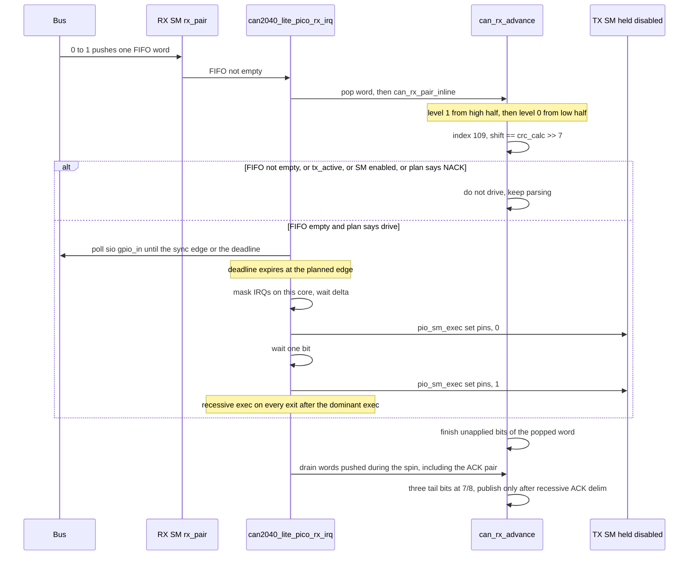
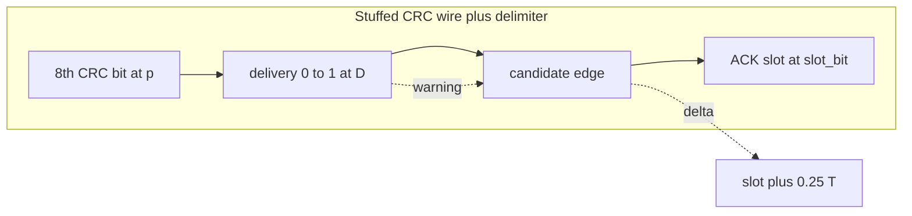

# ACK generation: CPU sync-edge pulse

| | |
|---|---|
| **Status** | Draft |
| **Author** | (placeholder) |
| **Date** | 2026-11-14 |
| **Supersedes** | The `can_ack` PIO overlay of the TX slot in `docs/ack_generation.md` (13 words, Y gate, follow mode). That plan is recorded below as a superseded alternative. It is not the design. |
| **Decided** | Plan B. A CPU busy loop in the RX IRQ, locked to one bus edge, drives the inset ACK. No PIO ACK program. |

This document replaces the timing plan in `docs/ack_generation.md`. The protocol
section of that file (delimiter, slot, ACK delimiter, inset pulse, false ACK
worse than NACK, do not ACK own transmit) stays and is restated here so this
file stands alone.

---

## Overview

CAN2040-Lite receives on one PIO state machine (`rx_pair`, 7 words) and
transmits on a second (`can_tx`, 14 words). It does not yet drive a correct
ACK. The firmware that tries to is the TX-slot overlay: `build_ack` in
`src/pico/can_pio_program.c`, armed from `can_ack_plan` in `src/can_edge_sm.c`.
That overlay is not the live parser path. `can2040_lite_pico_rx_irq` feeds
`can_rx_pair_inline` only. The undefined `edge_sm` is read by
`ack_service` (`can_edge_sm_past_ack_slot(&edge_sm)`), which has no
callers. Follow mode also sticks
after a recessive slot, because a NACK pushes no FIFO word and nothing
restarts the helper.

The replacement is a bounded spin inside the RX IRQ, and only then. When
`can_rx_advance` reaches bit index 109 (`CAN_BIT_CRC_FIRST + 7` in
`src/can_bit_layout.h`) and the first eight CRC bits match
`crc_calc >> 7`, the handler checks the RX FIFO. If the FIFO is not empty,
or this node is transmitting, the frame stays a NACK and the pad stays
recessive. If the FIFO is empty, the handler starts polling the RX pad
before a sync edge chosen by a host test, waits a planned delta, and
injects a one-bit dominant pulse on the TX state machine that already owns
the pad. The pulse is dominant from 0.25 T to 1.25 T of the ACK slot. The
handler then releases the pad, finishes the FIFO word it had already
popped, drains the words that arrived during the spin, and lets the
existing parser sample its own pulse.

The sync edge is not chosen in this document. A PC test over every CRC
value and every legal incoming run scores every later falling edge and
every later rising edge. It publishes one winning polarity and occurrence
per warning floor. Inputs that have no eligible edge at the floor the
setup measurement selects are explicit NACKs. The share is whatever
coverage that row prints.

The IRQ cost is an accepted penalty. The only ceiling used below is the
pre-test note's: at most about 11.25 bit times from the delivery rise
through the recessive release. That note's span from the delivery edge
to the slot was 10 bit times, and it did not score falling edges. At
1 Mbit/s the ceiling is about 12 µs; at 125 kbit/s about 90 µs. The
sweep remeasures the span. Firmware does not bake in 10, 11.25, or 18.

---

## Background and motivation

### What the bus requires

Classic CAN ACK is two bit times wide on the wire only in the sense that
the field has a slot and a delimiter. The acknowledgement itself is one
dominant bit in the slot. Three sample points matter. T is the nominal bit
time. The transmitter's sample point sits in about 0.75 T to 0.875 T. This
node's own parser samples at 7/8 T (`can_edge_sm.c`, `ticks_per_bit * 7 / 8`,
`off <= sample`).

```
... C15 | D | A | Ad | EOF ...
         ^   ^   ^
         |   |   ACK delimiter must be recessive at its sample
         |   ACK slot must be dominant at its sample
         CRC delimiter must be recessive at its sample
```

A dominant level at either delimiter sample is a form error. A pulse that
misses the slot sample is a NACK. A NACK makes a compliant transmitter
retry. A false ACK makes it keep a frame this node may then drop. False
ACK is the worse failure, and every exit path below prefers NACK.

### The inset

The pulse stays the one already specified. Dominant from **0.25 T to
1.25 T** of the ACK slot: one bit wide, starting a quarter bit after the
slot boundary. Against the sample window this document keeps (dominant
over 0.50 T through 0.90 T of the slot):

| placement error δ (pulse moves later) | constraint | limit |
|---|---|---|
| late, still cover the 0.50 T sample | 0.25 + δ ≤ 0.50 | δ ≤ +0.25 T |
| early, still cover the 0.90 T sample | 1.25 + δ ≥ 0.90 | δ ≥ −0.35 T |
| early, miss a CRC-delimiter sample at slot − 0.25 (SP = 0.75) | 0.25 + δ > −0.25 | δ > −0.50 T |
| early, miss a CRC-delimiter sample at slot − 0.125 (SP = 0.875) | 0.25 + δ > −0.125 | δ > −0.375 T |
| late, hit an ACK-delimiter sample at slot + 1.75 (SP = 0.75) | 1.25 + δ < 1.75 | δ < +0.50 T |

The binding window is **−0.35 T to +0.25 T**. The old "about ±0.3 bit"
sentence is this window, and the late side is the tight one. A pulse that
starts on the slot boundary has only about 0.2 T of early margin before
it covers the CRC-delimiter sample; the inset exists to buy the late side
instead. The parser comparison is `off <= sample`, so an edge exactly at
7/8 T still updates the sample. The inset is dominant at 7/8 T (0.875 is
inside (0.25, 1.25)) and recessive at both delimiter samples.

### Why the overlay is not the base

The current document's timing path is the 13-word `can_ack` image. It
follows edges in the TX slot, counts down in X, and pulses only if Y was
set after a full CRC match. That lost on four facts already in the tree:

1. The live IRQ never runs it. `can2040_lite_pico_rx_irq`
   (`src/pico/can2040_lite_pico.cpp`) pops RX words and calls
   `can_rx_pair_inline`. Nothing on that path calls the overlay.
   `ack_service` reads `edge_sm`, which has no definition, and nothing
   calls `ack_service`. With `CAN_ACK_GENERATION_SUPPORT`
   left at its default of 1, the overlay is not a working ACK.
2. A recessive slot produces no edge and no IRQ. Follow mode was specified
   to restart only when the PC is in `release` and the parser is past the
   slot. That restart never runs, so the helper stays in `release`. The
   old document already calls this out.
3. Arming does not recompute `from_bit` after the pad moves, and it does
   not require the next counted edge to be one bit away. A stale X must
   not pulse. The old document already calls this out too.
4. The allow has 1.25 T after the worst FIFO push that completes the CRC.
   At 1 Mbit/s that is 1.25 µs, under USB and stepper load. The overlay's
   answer to a missed window was "option D", a bit-level CRC in PIO. This
   plan does not build that program.

The stuffing model next to the overlay is still right. `can_ack_plan`
walks the 15 CRC bits with the same rule as the receiver: a run of 5
inserts the opposite bit and restarts the run at 1, and a CRC that ends
on a 5-run still owes one stuff bit before the recessive delimiter.
`slot_bit` is then 16 to 20 wire bits from the first CRC bit through the
delimiter. This plan calls that function. It does not grow a second
stuffer.

### What the receiver knows at bit 109

`CAN_BIT_CRC_FIRST` is 102. Case `CAN_BIT_CRC_FIRST + 7` is bit index
**109**, the eighth CRC bit. `can_rx_advance` has been shifting received
bits into `rx->shift`. CRC-15 in `rx->sm.crc_calc` is updated only while
`i < CAN_BIT_CRC_FIRST`, so at index 109 `crc_calc` is still the CRC over
SOF through data, and `crc_calc >> 7` is the expected top eight bits:

```116:121:src/can_rx_sm_inline.h
    case CAN_BIT_CRC_FIRST + 7u:
        if (rx->shift != (uint8_t)(rx->sm.crc_calc >> 7)) {
            can_rx_fail_rx(rx, CAN_RX_CRC_ERROR);
            return;
        }
        break;
```

The low seven bits are checked later, at `CAN_BIT_CRC_LAST` (116), against
`crc_calc & 0x7f`. They are not known at the hook. That hole is a rated
risk, not an oversight. See Risks.

A stuff error or a CRC error before index 109 never reaches the case.
`can_rx_fail_rx` sets `i` to `CAN_BIT_WAIT_FRAME` and returns. The hook
must sit after the compare, on the match path only.

---

## Goals and non-goals

### Goals

- Drive an inset ACK for a frame this node did not transmit, when the
  first eight CRC bits match and a host-selected sync edge still lies in
  the future with the FIFO empty.
- Lock the pulse to a bus edge so the open-loop interval is the gap from
  that edge to slot+0.25 T, not the gap from SOF or from CRC start.
- Let the live parser (`can_rx_*`) count the pulse as ACK only when the
  7/8 T sample of the slot is dominant, and as a form error when a
  delimiter sample is dominant.
- Keep one stuffer: `can_ack_plan`.
- Keep two PIO state machines and the 7 + 14 = 21 word image. Add no ACK
  program and no third SM.
- Decide the sync edge by a test. Coverage, minimum warning, maximum
  delta, and maximum FIFO count are assertions on a table, one row per
  warning floor. The firmware uses the row the setup measurement selects.
- Leave the pad recessive on every path that is not the planned pulse.

### Non-goals

- A PIO ACK program, a Y gate, follow mode, or a third state machine.
  Option D (CRC matched in PIO) stays parked. It is not a fallback this
  plan builds.
- Error flags, TEC/REC, bus-off, automatic retransmission, RTR reply, CAN
  FD, or a programmable sample point.
- ACK of this node's own transmit, including loopback of that transmit.
- Recovering inputs the sweep leaves uncovered at the selected floor.
  That share is whatever coverage the table prints, not the old
  rising-edge note. Those frames are NACKs. The transmitter retries.
- Knowing CRC bits 9–15 before the pulse. The hook does not wait for them.
- A fixed 18 µs spin, a microsecond hardware alarm, or `time_us_32` as
  the delay (1 µs is one bit at 1 Mbit/s, and RP2040 has no CYCCNT).
- Changing GPIO function or direction from the ISR.

---

## Proposed design

### End-to-end sequence



The spin returns into the same `can_rx_advance` call that matched. The
`while (n--)` loop in `can_rx_state` then emits the rest of that run, and
`can_rx_pair_inline` emits the other half of the word if it has not run
yet. The IRQ's existing drain loop then takes the words that queued
during the spin. No second parser and no second drain.

```638:659:src/pico/can2040_lite_pico.cpp
extern "C" void can2040_lite_pico_rx_irq(void) {
    ...
    while (!pio_sm_is_rx_fifo_empty(rx_pio, rx_sm)) {
        const uint32_t word = pio_sm_get(rx_pio, rx_sm);
        can_rx_pair_inline(&rx, word);
    }
}
```

The hook runs inside that `while`, on the word already popped. "FIFO
empty" means no later pair has been pushed yet.

### Wire model

Time 0 is the first CRC data bit. At the hook `rx->crc_run` is 1..4,
never 5, and `rx->crc_last` is the level of the bit immediately before
that data bit: the inserted stuff bit's level when one was required,
otherwise the previous data bit. `can_ack_plan(crc, run, last, …)` with
`run` in 1..4 uses that epoch, so index 0 is the first CRC data bit.
`can_ack_plan(crc, 5, last, 0)` is a different epoch. Time 0 there is the
owed stuff bit, and the existing unit test locks `slot_bit == 20`. The
sweep and the latch do not call it. `can_ack_plan` appends the recessive
delimiter and reports `slot_bit` as the wire index of the ACK slot. The
slot therefore starts at time `slot_bit`. The delimiter occupies
`[slot_bit - 1, slot_bit)` and is recessive.

An edge at time `i` is the boundary at the start of wire bit `i`. It is
1→0 when the previous level is 1 and wire bit `i` is 0, and 0→1 in the
opposite case. The previous level of bit 0 is `last`.

`build_rx_pair` pushes one FIFO word per dominant pulse, at the 0→1. The
high half is X at the 1→0. The low half is X at the 0→1. A 1→0 does not
itself push. `can_rx_pair_inline` feeds level 1 from the high half, then
level 0 from the low half. The level argument is the run that just ended,
not the level after the edge:

```238:242:src/can_rx_sm_inline.h
static inline void can_rx_pair_inline(can_rx_t *rx, uint32_t word) {
    can_rx_edge_inline(rx, (uint16_t)(word >> 16), 1u);
    can_rx_edge_inline(rx, (uint16_t)word, 0u);
}
```

The word is popped before those bits run. The IRQ cannot observe index
109 until the rise that pushes the pair containing that bit.

Bit index 109 is the eighth CRC bit, not the eighth wire bit. Stuff bits
do not advance `rx->i`. Its wire index `p` is the index of CRC bit 7
(0-based, MSB first) in the stuffed wire.

Delivery rise `D`:

- If wire bit `p` is dominant, `D` is the next 0→1 with time `> p`. That
  rise exists and is strictly before the slot: the delimiter is recessive,
  so a dominant run ends at or before the start of the delimiter.
- If wire bit `p` is recessive, `D` is the 0→1 that closes the next
  dominant pulse after `p`. That is the first 1→0 with time `> p`, then
  the first 0→1 after that fall. The recessive bits are in the high half
  of that word; the CPU still sees them only after the push at `D`. If
  there is no such fall before the slot, the bit sits in the quiet tail
  and the hook never runs in time. That input is an explicit NACK
  (`no_delivery`). A suffix of recessive CRC bits long enough to reach
  from the eighth CRC bit to the delimiter has to be stuffed, so this
  count may be zero. The test asserts the count. This document does not.

Candidates are edges with `D < time < slot_bit`. The delivery rise itself
is already in the popped word. Edges of that same word at times `≤ D`
have already happened on the wire.



### The host test decides the edge

The first change is a host test, not firmware. It lives at
`extras/tests/pc_based/ack_sync_edge.c`. `make test` in that directory
already links `can_test_units.c`, `src/*.c`, and
`src/pico/can_pio_program.c`. It does not link `can2040_lite_pico.cpp`.
Adding `ack_sync_edge.c` to that link line is required. "No Pico backend"
means the cpp file only.

`TEST_BEGIN` / `CHECK` / `TEST_END` are macros over `static` counters in
`can_test_units.c`. A second `.c` file cannot increment `g_failed`.
`ack_sync_edge.c` does not call them. It returns the table below.
`can_test_units.c` calls it once and runs the `CHECK`s. No GPIO and no
PIO exec.

```c
typedef struct {
    uint8_t  pol_fall;      /* 1: winner is 1→0; 0: winner is 0→1 */
    int8_t   occurrence;    /* the rank that won at this floor */
    uint32_t covered;
    uint32_t domain;        /* 262144 */
    uint16_t min_warning;   /* bit times, among covered inputs */
    uint16_t max_delta_q4;
    uint8_t  max_fifo;
    uint32_t no_delivery;
} ack_sync_floor_row_t;

/* rows[0] is floor 1, rows[11] is floor 12.
   Returns 0 when the lockstep matched and each row strictly beats
   every other policy at that floor. */
int ack_sync_edge_sweep(ack_sync_floor_row_t *rows);
```

Domain, one epoch only: every `crc` in `0 .. 32767`, every `run` in
`1 .. 4`, every `last` in `{0, 1}`. That is 262144 inputs. `run == 5` is
not in the domain. It is the pre-stuff epoch of the stuffer unit test
(`can_ack_plan` time 0 is the owed stuff bit, `slot_bit == 20` when the
run enters at 5). `crc_field_state` consumes a run of 5 before it
reports the CRC-entry state, so the value it returns is never 5. The
sweep does not ask it to be.

Wire levels come from `can_ack_plan`, not from a private copy used as the
authority. For each input the test reads

```c
can_ack_plan(crc, run, last, i).level
```

for `i` in `0 .. slot_bit - 1`, and checks that every call reports the
same `slot_bit`. A lockstep walker then applies the rule in the comment
above `can_ack_plan` (run of 5 inserts the opposite bit, trailing stuff
before the delimiter, delimiter is 1) and must reproduce those levels and
that `slot_bit` before any edge is scored. A mismatch fails the test.
The walker exists only so the test can name the wire index of the eighth
CRC data bit. Production code does not call it. PR 2 deletes the copy
and shares the walker inside `can_ack_plan`.

For each candidate the sweep records:

| field | meaning |
|---|---|
| polarity | 1→0 or 0→1 |
| occurrence | `+k` is the k-th candidate of that polarity after `D` (`+1` is next); `−k` is the k-th from the end (`−1` is last). One edge carries both ranks. |
| warning | `time − D`, in bit times. The busy loop has to be sampling the pad before this edge. `D` is the delivery rise only. |
| delta | `(slot_bit + 0.25) − time`, in quarter-bits. Open-loop wait from the edge to the start of the inset. Not `D`. |
| fifo | number of 0→1 pushes with `D < time < slot_bit + 1.25`. The ACK pulse is one more push, at release (`slot + 1.25`), and is not included. |

Times of wire edges are integers, so warning is an integer number of bit
times and delta is `4 * (slot_bit − time) + 1` quarter-bits. The test
stores both in quarter-bits.

The warning floor is a parameter, not a constant of this document. For
each integer floor `w` in `1 .. 12` a candidate is eligible when:

- it is strictly after `D` and strictly before the slot;
- warning ≥ `w`;
- delta ≤ `ACK_SYNC_DELTA_MAX_Q4` (12 bit times, 48 quarter-bits);
- `fifo ≤ 7`.

There is no `ACK_SYNC_WARN_MIN_BITS` of 2. Two bit times is one pair
period of an alternating stream, and the old rising-edge note's minimum
warning to the last rise was 2, but neither fact is a measured
pop-to-sample cost. `docs/rx_bus_load.md` is the measurement that exists:
the first table is a full drain, average about 5.1 µs and max 15 µs, at
about 90% bus, FDEBUG 0; the later no-ACK window is mean 4.96 µs, about
660 cycles at 133 MHz, max 28 µs, 70.6% of core 1, timed with a 1 µs
counter. Two bit times at that clock are 266 cycles, which sits inside
that full-drain cost. The 660-cycle figure is not the interval from
`pio_sm_get` of the delivery word to the first pad sample. A floor inside
the real setup cost would mark edges as covered that the hook then takes
as `ack_skip_miss`. The floor firmware uses is chosen in PR 4, after that
interval is measured. Until then the test asserts the whole table.

The FIFO bound is a property of the input (it does not depend on which
candidate is chosen) but it is checked per candidate so a policy cannot
cover an input that would fill the joined RX FIFO. Depth is 8
(`PIO_FIFO_JOIN_RX` in `can2040_lite_pico_rx_init`). Seven wire pushes
leave the eighth slot for the release push. An eighth wire push is an
ineligible input, not a pulse.

A policy is one polarity and one occurrence in `±1 .. ±6`. The test
asserts that no input has seven or more candidate edges of one polarity;
if stuffing ever produces one, the search bound is wrong and the test
fails closed.

Total order, applied separately at each floor, to policies that cover at
least one input. Higher is better.

1. Coverage, the number of inputs that have that edge and pass the
   filters at this floor.
2. Minimum warning among covered inputs, larger first.
3. Maximum delta among covered inputs, smaller first.
4. Maximum FIFO count among covered inputs, smaller first.
5. Smaller absolute occurrence (a unique edge before a distant rank).
6. The later rank before the earlier one (`−1` before `+1`, `−1` before
   `−2`). This is the tie-break that prefers the shorter open loop when
   coverage and the worst-case warning are equal.
7. 1→0 before 0→1.

Key 7 exists so the order is total. It prefers a falling edge when every
earlier key ties, so the procedure does not default to a rising edge.
Keys 1–4 are the ones that should actually separate policies. The test
encodes this order and asserts that, at every floor, the selected policy
strictly beats every other searched policy.

`can_test_units.c` then asserts, as equalities, each row's polarity,
occurrence, covered count, domain size (262144), minimum warning, maximum
delta, maximum FIFO count, and `no_delivery`. Those integers are whatever
the first green run prints. They are not in this document, and they are
not taken from the old manual note. They describe the wire at every
floor. They do not name the row firmware will compile. That selection is
PR 4. A later change of floor re-reads this table. It does not resweep
by hand and it does not edit a rank while keeping the same floor.

That note, kept only so a reader can see what the test replaces: about
93.2% of inputs had a rising edge strictly before the slot that could be
used as the last rise; 6.8% were too late for a later rising edge; future
rising edges were 1..4; the minimum warning to the last rise was 2 bit
times; the maximum span from the bit-109 delivery edge to the slot was
10 bit times at 1 Mbit/s. Falling edges were not scored. The test scores
them. Do not treat the note as the result, do not treat 6.8% as this
plan's NACK rate, and do not hard-code "last rising edge" as the policy.
If the order above selects that policy at some floor, the equality
assertions for that row are what say so, not this text.

`ACK_SYNC_DELTA_MAX_Q4` is 12 bit times from the error budget below. It
is an eligibility cap, not the measured maximum. Each row's asserted
maximum delta is its own number and will be tighter. The symbol for that
interval is delta. `D` stays the delivery rise.

### Pure function

PR 2 adds, next to `can_ack_plan` and behind the same
`CAN_ACK_GENERATION_SUPPORT` flag:

```c
typedef struct {
    uint8_t drive;       /* 1 pulse, 0 NACK */
    uint8_t rise;        /* 1: sync on 0→1; 0: sync on 1→0 */
    int8_t  occurrence;  /* rank for this warn_min; meaningful if drive */
    uint16_t warning_q4; /* (time - D) * 4; 0 if NACK */
    uint16_t delta_q4;   /* ((slot + 0.25) - time) * 4; 0 if NACK */
} can_ack_sync_t;

can_ack_sync_t can_ack_sync(uint16_t crc, uint8_t run, uint8_t last,
                            uint8_t warn_min);
```

`warn_min` selects a row of the sweep table. It does not re-rank. PR 2
stores the twelve `(polarity, occurrence)` pairs the sweep asserted, one
per floor in 1..12. For a call, the function walks the wire once, looks
up that floor's rank, and sets `drive` only when that rank exists on
this input and passes the same delta and FIFO filters at that floor.
`run < 1` or `run > 4`, and `warn_min` outside 1..12, return
`drive == 0`. That includes `run == 5`. The pre-stuff epoch is not a
state the hook produces, and pulsing from it would be the wrong wire
plan.

The function does not search the domain per frame. A per-frame argmax
would ACK a different set whenever an uncovered input had an eligible
edge of the other polarity. The sweep is what shows that, per floor.
The ISR stays one table lookup and one compare.

Host tests call `can_ack_sync` on the whole primary domain at every
floor and require byte-identical results to that row of the sweep,
including every NACK. There is no single baked rank beside the table.
Which row the IRQ passes is PR 4's constant, not a second search.

The walker is the one inside `can_ack_plan`, pulled into a file-local
helper both functions call. `can_ack_plan`'s results stay, including
the `run == 5` unit test (`slot_bit == 20`). Its other tests in
`can_test_units.c` stay. No second stuffing rule.

### Latch at CRC entry

`can_ack_sync` needs the run state at the first CRC data bit. That is
the post-stuff state `crc_field_state` returns and the state
`can_edge_sm` snaps into `crc_run_start` / `crc_last_start`.

The snapshot in `can_edge_sm` is the `rem == 15` block inside
`parse_bit`, before `note_run`. `feed_raw` has already dropped a stuff
bit and set `run = 1` when one was owed, so the snapped run is 1..4.
`crc_field_state` consumes a run of 5 before the `got == crc_start`
break, so the run it returns is never 5. The latch matches that epoch.
It does not match `can_ack_plan(..., 5, ...)`, whose time 0 is the owed
stuff bit.

`can_rx` does not store a run today. The bytes, the tail fields the
readback section uses, and the per-test hook pointer:

```c
uint8_t crc_run;      /* 1..4 at the first CRC data bit */
uint8_t crc_last;     /* level of the bit before that data bit */
uint8_t crc_latched;  /* 0 until that snapshot is taken */
uint8_t ack_pending;  /* ACK slot sampled dominant; publish waits */
uint8_t tail_on;
uint8_t tail_sample;  /* post-edge level of the open tail bit */
uint16_t tail_mark;   /* down-counter time of that bit's start */
void (*ack_hook)(can_rx_t *rx); /* nullable; host tests only */
```

Maintaining `run` / `last` with the same update as `note_run` is the
latch. An identical bit increments, an opposite bit restarts at 1, and
a dropped stuff bit sets the run to 1 at the stuff level before `i`
moves. `drop_next` is already 1 exactly when the previous run hit 5.
The stuff bit is not passed to `can_rx_advance`.

The snapshot is taken when a bit is about to be shifted in,
`rx->i == CAN_BIT_CRC_FIRST`, and `crc_latched` is still 0, before
`note_run` sees that bit. An owed stuff bit was dropped first, so
`crc_run` is 1..4. At bit 109, `rx->crc_run` is 1..4.

`can_rx_reset` is not the frame boundary. It sets `i`, `drop_next`, and
the ring indices, and the Pico backend calls it from
`can2040_lite_pico_rx_arm`, not from the parser. A good frame and
`can_rx_fail_rx` both set `i = CAN_BIT_WAIT_FRAME` and return. The
`CAN_BIT_WAIT_FRAME` arm only zeroes `crc_calc` and points `i` at the
first ID bit. Clear `crc_latched`, `ack_pending`, and `tail_on` in that
arm and in `can_rx_fail_rx`. Also clear them in `can_rx_reset` so a
re-arm is clean. The per-frame clears are the arm and `can_rx_fail_rx`.
A sticky `crc_latched` keeps the first frame's `crc_run` / `crc_last`,
and the hook then pulses from the wrong wire plan. Wrong `slot_bit` is
a dominant bit in a delimiter, which this document ranks worse than a
NACK. If the hook runs with `crc_latched == 0`, it does not pulse.

The host latch test feeds two different built frames, back to back,
through `can_rx_pair`. After each frame's first CRC data bit,
`crc_run` / `crc_last` match that frame's `crc_field_state`. The second
latch must change when the two frames differ. A frame that fails before
the CRC, followed by a good frame, must latch the second frame. The
test does not require `run == 5`. The existing
`can_ack_plan(crc, 5, last, 0)` case stays a stuffer unit test and is
not a latch case.

The latch is two compares on the hot path. Do not size it from a
"one-word body is hundreds of cycles" note. That sentence is not in
`docs/`. The figure that is there is `docs/rx_bus_load.md`: mean ISR
4.96 µs, about 660 cycles at 133 MHz, for a full drain timed with a
1 µs counter, max 28 µs in that window, and 15 µs max in the earlier
table. The spin below is the cost that matters. The pop-to-sample
interval is `setup_cycles`, measured on target in PR 4, not inferred
from the full-drain mean.

### IRQ hook

After the eight-bit compare succeeds, and only then:

```c
case CAN_BIT_CRC_FIRST + 7u: /* 109 */
    if (rx->shift != (uint8_t)(rx->sm.crc_calc >> 7)) {
        can_rx_fail_rx(rx, CAN_RX_CRC_ERROR);
        return;
    }
#if CAN_ACK_GENERATION_SUPPORT
    can_rx_ack_hook(rx);
#endif
    break;
```

`can_rx_ack_hook` is a weak symbol in `can_rx_sm.c`. The weak body calls
`rx->ack_hook` when that pointer is non-NULL and otherwise returns. The
Pico backend provides a strong `can_rx_ack_hook` that does not call the
pointer. That is the same shape as `can2040_lite_hw_attach`: the weak
definition in `src/can2040_lite_test.inc` is the host binary, and the
strong definition in `can2040_lite_pico.cpp` replaces it only in the
Pico binary. It is not a way to give two tests in one binary two
different hooks. One strong symbol would win for every test in
`can_test_units`.

Host tests that must not pulse leave `ack_hook` NULL. Host tests of the
timing model set `ack_hook` to a recorder for that test only. They do
not define `can_rx_ack_hook`. The Pico override ignores the pointer, so
a NULL `ack_hook` on the target is the normal state.

The strong body, behind the flag, in one `__not_in_flash_func`:

1. `tx_active` here is the file-scope `static bool tx_active` in
   `can2040_lite_pico.cpp`. It is not `struct can2040_lite.tx_active`.
   `can2040_lite_pio_irq_handler` ignores `cd`, so the struct field is
   not visible in the IRQ. If that static is set, or TX was not
   initialized, or `gpio_tx < 0`, or `pio_sm_is_enabled(tx_pio, tx_sm)`
   is true, count `ack_skip_tx` and return. Do not execute anything on
   the TX SM. Own transmit is in `can_tx`, which writes the pad with
   `mov pins, x` every bit. An injected `set pins` on an enabled SM
   replaces the next instruction instead of running immediately, and it
   races the shifter. Receive-only has no TX pad.

   The enabled-SM check is load-bearing because the static is not a
   reliable idle signal today. `can2040_lite_pico_tx_frame` sets the
   static and enables the SM. Nothing on the TX-success path disables it. The disables in the file
   are init, the disable-then-enable inside `ack_start_follow`,
   `ack_abort_for_tx`, `launch_fail`, and `pico_hw_stop`. The program
   parks on a jump, still enabled, and that
   park instruction does not write the pin. With the flag at 1, TX
   completion sets `tx_done_seen` and does not clear the static. The
   clear lives in `ack_service`, which has no callers. With the flag at
   0, `pico_service_events` clears the static and still leaves the SM
   enabled. `docs/ack_generation.md` §4 is the sentence that matches the
   flag-1 path: "The TX SM is enabled between frames." Disabled between
   frames is only the flag-0 moment before the first `tx_frame`. The
   post-TX step below repairs that before any pulse, for both flag
   values. `ack_start_follow` is deleted in that same change. Init and
   `can2040_lite_pico_rx_arm` call it today, and it enables the SM.
   It does not reference `edge_sm`. The undefined identifier is in
   `ack_service`, which has no callers. Leaving `ack_start_follow`
   would re-enable a follower after the repair.

2. If `!pio_sm_is_rx_fifo_empty(rx_pio, rx_sm)`, count `ack_skip_fifo`
   and return. A pair has already been pushed since this word was
   popped. The sync edge may be inside it. Spinning would also stall
   the drain. The frame stays a NACK. The `while` in the IRQ drains the
   queued words after `can_rx_pair_inline` returns.

3. `plan = can_ack_sync(rx->sm.crc_calc, rx->crc_run, rx->crc_last, warn_min)`.
   `warn_min` is the floor PR 4 selected, a compiled constant, not a
   per-frame argument. If `!plan.drive` or `crc_latched == 0`, count
   `ack_skip_plan` and return.

4. The poll reads `sio_hw->gpio_in` for the RX pad bit. It does not call
   `gpio_get` and it does not inject `in pins`. The deadline expires at
   the planned edge, not a full warning after the hook is entered.
   Warning is `time − D`, the gap from the delivery rise, and the pop
   plus the parse to bit 109 have already spent part of it. At hook
   entry:

   ```text
   warning_cycles = plan.warning_q4 * cycles_per_bit / 4
   if (warning_cycles <= setup_cycles) ack_skip_miss and return
   deadline_cycles = warning_cycles - setup_cycles
   ```

   `setup_cycles` is an upper bound measured in PR 4, from `pio_sm_get`
   of the delivery word to the first `sio_hw->gpio_in` sample, worst
   case over where bit 109 sits in that word. `cycles_per_bit` is
   `clock_get_hz(clk_sys) / bitrate`. If the remaining time is already
   gone, do not poll. A poll that started a full `warning_q4` at hook
   entry would run past the planned edge by the parse latency and could
   accept a later stuff edge or the next SOF.

5. Inside that deadline the poll has to see the transition.
   - 0→1 (`plan.rise`): a sample of 0, then a sample of 1. Already 1
     on the first sample is a miss.
   - 1→0: a sample of 1, then a sample of 0. If the line never reads 0,
     including a line that stays 1 for the whole window, that is a
     miss. A falling edge whose dominant pulse has already ended leaves
     the pad recessive, which is the pre-edge level. Treating "already
     at the post-edge level" as the only miss would call that "not yet"
     and then accept a later fall. That rule is not used.
   If the deadline expires without the transition, count `ack_skip_miss`
   and return without driving. Never treat a late edge as the edge.

6. From the sample that first saw the post-edge level,
   `save_and_disable_interrupts` on this core, and stay inside the same
   SRAM function through the delta wait, the dominant exec, the one-bit
   wait, and the recessive exec. Then `restore_interrupts`. The
   dominant interval is otherwise a CPU wait between two execs. A
   higher-priority IRQ during that wait lengthens the pulse. The late
   side of the inset is +0.25 T, and the ACK-delimiter sample at SP
   0.75 is only +0.50 T past the nominal end, so a few hundred
   nanoseconds of preemption at 1 Mbit/s is a form error. A pulse that
   already started is `ack_overrun`, not `ack_skip_miss`.
   `ack_skip_miss` means the pad was not driven.

7. Wait `plan.delta_q4` bit-quarters minus the calibrated poll and exec
   bias, then `pio_sm_exec` of `set pins, 0` on `tx_sm` through
   `pio_exec_bounded` (8-spin cap). Wait one bit time, minus the exec
   overhead, then `set pins, 1` the same way.

8. Every return after the dominant exec has run, including a return
   that notices the recessive deadline has already passed, issues
   `set pins, 1` before `restore_interrupts`. If that recessive exec
   lands after the ACK-delimiter sample deadline, count `ack_overrun`.
   The miss path never executed `set pins, 0` and does not count
   `ack_overrun`.

9. Return. The parser finishes the popped word and the IRQ drains.

There is no path that drives dominant and then returns without the
recessive exec. The 8-spin cap is load-bearing:
`docs/test_findings_fly_micro4.md` §6 records a 4.4 s IRQ stall from a
blocking ACK exec. The new loop must not call an unbounded PIO wait,
and it must not enable the TX SM to run the pulse.

The loop ends when the pad is released. It does not spin for a fixed
18 µs, and it does not spin out the pre-test ceiling on a frame whose
own delta is shorter. The per-frame bound is the distance from the
delivery rise to slot+1.25 T.

Priority is decided here. Nothing in `src/` calls `irq_set_priority`.
`can2040_lite_pico_rx_init` already routes the RX FIFO to PIO IRQ 0
(`rx_irq_num = pio_get_irq_num(rx_pio, 0)`). In that init, call
`irq_set_priority(rx_irq_num, 0x00)`. On the RP2040 Cortex-M0+ a lower
number is a higher priority, and an equal priority does not preempt.
USB and a stepper IRQ left at the SDK default cannot enter during this
handler. The application owns the system-handler install and must not
move this IRQ off 0x00. The mask around the pulse stays anyway. A later
image that puts a still-higher source on this core either blows the
poll deadline and NACKs, or nests after the dominant exec, counts
`ack_overrun`, and still forces the pad recessive.

Cycle wait, one SRAM function for the poll and the quarter-bit wait, on
RP2040 and RP2350:

- It reads `sio_hw->gpio_in` directly.
- `time_us_32` is not usable. Its resolution is 1 µs, one bit at
  1 Mbit/s.
- RP2040 has no `DWT->CYCCNT`. RP2350 does. One implementation is used
  on both, so an XIP miss cannot stretch a bit.
- The cycle count of one poll iteration, and of one quarter-bit wait,
  comes from the disassembly listing and is stored as a named constant
  next to the function. The delta subtraction uses that constant. A
  `static_assert` on the encoded size, if kept at all, is only a "this
  function did not grow a call" guard. It is not a cycle count. Thumb
  width, a literal pool, and a non-inlined `gpio_get` change the count
  without a matching size failure, and a size match does not prove 8
  cycles. The poll does not call `gpio_get`, which is what keeps the
  listing count stable.
- Cycles per bit are `clock_get_hz(clk_sys) / bitrate`. At 125 MHz and
  1 Mbit/s that is 125. At 133 MHz, the fly-micro4 clock in
  `docs/rx_bus_load.md`, it is 133.
- Detection latency is a constant number of iterations of the listing
  count, subtracted from delta so the drive starts at slot+0.25 rather
  than one poll late. Residual jitter is ± one iteration.

Post-TX step, same PR as this hook, both values of
`CAN_ACK_GENERATION_SUPPORT`. On TX done or TX error, inside
`pico_service_events`, not in the RX IRQ, and not after
`can_edge_sm_past_ack_slot`:

1. `pio_exec_bounded` of `set pins, 1`, so the output latch is recessive.
2. `pio_sm_set_enabled(tx_pio, tx_sm, false)`.
3. If an ACK image was swapped in, copy `can_tx` back. The same commit
   deletes the overlay, so the steady state is `can_tx` disabled in the
   slot.
4. Clear the file-scope `tx_active` for both flag values. Today only the
   flag-0 arm clears it, and neither arm disables the SM.

After that, disabled between frames is the repaired state. The hook
still returns when `pio_sm_is_enabled` is true.

### Pin ownership

The TX SM owns the pad. `can2040_lite_pico_tx_init` sets
`sm_config_set_set_pins` and `sm_config_set_out_pins` to `gpio_tx` and
sets the direction to output, once, not from the ISR. End of init does
`pio_sm_set_enabled(..., false)`. That is not the steady state after the
first successful `can2040_lite_pico_tx_frame`, which enables the SM and
leaves it enabled. The post-TX step in the hook section is what disables
it again. The RX SM only `in`s and `jmp pin`s. It does not write the pin.

RP2040 PIO rule used here, and not approximated: on a given clock, if
several state machines write the same pin, the highest-numbered writer
wins; a state machine that does not write leaves the level unchanged.
During the pulse the TX SM must not also be executing `set pins` or
`mov pins`. That is why the post-TX step disables it, why the hook
returns when `pio_sm_is_enabled` is true, and why own-transmit returns
before any exec. A disabled SM runs an injected instruction immediately
and does not advance PC. An enabled SM does not. That is the SDK rule
the old ACK document already states, and it is why `pio_sm_exec` of
`set pins` is the pulse rather than a GPIO function change.

The output latch holds the level after the instruction. Dominant stays
dominant until the recessive exec. No delay slot in PIO is required, and
none is added.

The ISR must not call `gpio_set_function`, `gpio_set_dir`,
`pio_gpio_init`, or `pio_sm_set_consecutive_pindirs`. Any of those
glitches the mux on a live bus. The poll reads `sio_hw->gpio_in`
directly and does not call `gpio_get`. `gpio_get` is what
`ack_start_follow` uses today; that function is deleted with the
overlay. Do not sample the pad by injecting `in pins` into the RX SM.
That steals a shift from `rx_pair`, which is why the old document
refused to read RX X from software.

RX is claimed before TX (`pio_claim_unused_sm` in `can2040_lite_pico_rx_init`,
then in `can2040_lite_pico_tx_init`), so the usual assignment is SM0 RX
and SM1 TX, matching `docs/tdd_plan.md`. The pulse does not depend on
that numeric order. It depends on the RX SM not writing, and on the TX
SM being the one whose SET mapping is the TX pad, and on that SM being
disabled for the exec.

On a transceiver, RX and TX are different pins and the bus is wired-AND.
The sync edge is sampled on RX. The pulse is driven on TX. The
transceiver's TX delay is a late bias in the budget below. On loopback
the pins are the same GPIO. Polling stops before the dominant exec, so
the loop does not observe its own drive as the sync edge.

### Readback

The live parser quantizes an edge-to-edge gap to a whole number of bits.
`can_rx_state` accepts gap `n` only when `run_lo[n] ≤ delta ≤ run_hi[n]`,
with the half-width computed in `can_rx_sm.c` as `nominal/200 + T/8 + 1`
tick. At the fly-micro4 clock (133 MHz, 1 Mbit/s, 66 ticks/bit) the n=1
window is 57..75 ticks. A +0.25 T offset is about 16 ticks, which falls
between windows. Feeding the inset pair through that classifier is a bit
error, a `can_rx_quiet_tail`, or a false SOF on the release rise.

`can_edge_sm` already samples the delimiter, the slot, and the ACK
delimiter at 7/8 T, and `drive_ack_pulse` in `can_test_units.c` locks the
inset on that machine. The nominal pulse is `ack == 1`. A pulse that
ends before the sample or starts after it is a NACK. A pulse that covers
a delimiter sample is `INVALID_BIT`. That machine is not on the IRQ
path, and this plan does not put it there. `edge_sm` stays undefined.
The 7/8 rule moves to `can_rx` for three bits only, behind the flag, as
a walker. Do not add the compare inside the run-window loop. Today's
`run_lo` / `run_hi` stay for the stuffed region.

`can_rx_pair_inline` passes level 1 on the 1→0 timestamp and level 0 on
the 0→1 timestamp. That argument is the wire level of the run that just
ended. The comment in `can_rx_sm.h` that says "level after the edge" is
stale. `can_edge_sm_push` stores the other convention:
`can_edge_pair_push` passes 0 on the fall and 1 on the rise, and
`tail_sample = new_level` is the level after the edge. Copying
`off <= ticks * 7 / 8` onto `can_rx_state`'s `level` inverts the sample.
The walker stores the post-edge level: 0 at a 1→0, 1 at a 0→1.

Phase anchor. Later times are smaller, and every tail subtraction is a
`uint16_t`, so the down-counter wrap is just that subtraction. When the
bit just accepted is `CAN_BIT_CRC_LAST`, stop the `while (n--)` loop
even if classified bits of that run remain. Set `tail_on`. `tail_mark`
is the end time of that last stuffed bit, which is the start of the CRC
delimiter. If that bit is bit `k` of a run of `n` (0-based) whose
closing edge is at `time16`:

```text
tail_mark = (uint16_t)(time16 + (uint16_t)((n - 1 - k) * ticks_per_bit))
```

The closing edge is the end of bit `n - 1`. Earlier bits end at a
larger counter value. `tail_sample` starts as the wire level of that
last stuffed bit, which is the run's level, not the post-edge level.
That same call then runs the walker on the closing edge. The edge is
at the boundary when `k == n - 1`, and after it when `k < n - 1`.
Both are in range for a classified run.

`can_edge_sm` already samples the boundary edge. `enter_delim` sets
`tail_mark = bit_end` and `tail_sample = sm->level`. When CRC_LAST
closes the run, `crc_done` calls `enter_delim` with `bit_end` equal to
the edge time, and `can_edge_sm_push` then takes the `ST_DELIM` path:
`elapsed_ticks` is earlier minus later, so `off == 0`, and
`off <= ticks_per_bit * 7 / 8` writes `new_level` into `tail_sample`.

When `k == n - 1`, `tail_mark == time16`. Walker step 1 sees elapsed 0
and emits nothing. Step 2 sees `off == 0` and stores the post-edge
level before the call returns. The CRC delimiter is recessive. A
dominant CRC_LAST changes level on this boundary (0→1), so the stored
sample is recessive, and the later emit of the delimiter uses it.
Leaving the run level in `tail_sample` would feed the delimiter arm a
dominant bit, `can_rx_fail_rx(rx, CAN_RX_BIT_ERROR)` would drop the
frame, and the header default of flag 1 would fail the DLC sweep. Do
not emit the delimiter in this call. Elapsed 0 has not reached its
sample. The unmatched-delta handoff below uses the same two steps when
its edge lands on the boundary.

Walker, flag 1 only, while `tail_on` is set and `i` is
`CAN_BIT_CRC_DELIMITER`, `CAN_BIT_ACK_SLOT`, or `CAN_BIT_ACK_DELIMITER`.
On an edge at `time16` with post-edge level `post`:

1. Emit every tail bit whose end is at or before the edge. A bit ends
   when `(uint16_t)(tail_mark - time16) >= ticks_per_bit`. Emit with
   `can_rx_advance(rx, tail_sample)`, then
   `tail_mark = (uint16_t)(tail_mark - ticks_per_bit)`. Bits close on
   the sample latched before this edge. That is `advance_to`'s order.
   After each emit that leaves a tail bit open (`i` is still the CRC
   delimiter, the slot, or the ACK delimiter), seed `tail_sample` with
   the pre-edge wire level before the next emit and before step 2.
   That level is the run that just ended: the `level` argument
   `can_rx_state` already has. It is `sm->level` while
   `can_edge_sm_push` is still inside `advance_to`. `can_edge_sm`
   writes it on the way out of `ST_DELIM` and out of `ST_ACK`
   (`tail_sample = sm->level`, `src/can_edge_sm.c`) before the push
   applies `new_level`. If the arm reached `CAN_BIT_WAIT_FRAME` or
   failed, stop the loop and do not seed. If the loop emitted nothing,
   do not change `tail_sample`. An edge still inside the open bit must
   keep the sample an earlier edge stored.
2. Then `off = (uint16_t)(tail_mark - time16)`. If
   `off <= ticks_per_bit * 7 / 8`, set `tail_sample = post`, which
   overwrites the seed. Otherwise leave the seed. An edge past 7/8
   belongs to the next bit and keeps the level that was already on the
   wire at the sample point. Step 1 already closed the previous bit
   when a whole bit had elapsed. Same compare as `can_edge_sm_push`.

Where the walker runs. While `tail_on` is set, `can_rx_state` calls
the walker before the `run_lo` / `run_hi` loop, then returns. A gap
inside the n=1 window is not classified. At 66 ticks/bit that window
is 57..75, and the inset rise is 1.0 T wide, so it is an n=1 gap.
`can_rx_pair_inline` passes the level of the run that just ended: 1 on
the 1→0, 0 on the 0→1. That argument is the pre-edge level, and it is
the seed. The walker stores the other value, the post-edge level, only
in step 2 and only when `off <= 7/8`. Feeding the pre-edge 0 through
`while (n--)` once `i` is
`CAN_BIT_ACK_DELIMITER` hits the new arm as a dominant delimiter and
takes `CAN_RX_BIT_ERROR`. The `ack_guard` split stays in the `n == 0`
branch, and that branch runs only while `tail_on` is still 0.

Close after the rise, in that same call. There is no time catch-up.
`can_rx` has no `can_edge_sm_time`. `build_rx_pair` pushes one word per
dominant pulse. After the ACK rise the bus stays recessive through EOF
and IFS, so the IRQ gets no later word. Publish exists only in the
ACK-delimiter arm, and step 1 emits a tail bit only when a whole bit
has elapsed. A whole-bit ACK from `can_frame_build` places its last
edge at the delimiter start: the slot is dominant, the ACK delimiter,
seven EOF bits, and three IFS bits are recessive
(`extras/tests/common/can_frame_build.c`). The inset rise is 0.25 T
into the delimiter. Both are `off <= 7/8` of that bit, so step 1 never
emits it. `drive_ack_pulse` finishes with `can_edge_sm_time`, which is
`advance_to` and needs no later edge. `drive_rx_pairs` returns as soon
as `can_rx_available` is true. `test_rx_sm` (`ack == 1`) and the third
frame of `test_rx_sm_no_ack_gap` require that publish. Waiting for a
later SOF, about eleven bit times of delimiter plus EOF plus IFS,
would emit the pending bit by consuming the SOF: `can_rx_edge_inline`
has already stored that timestamp in `prev_time16`. At 66 ticks/bit
the `uint16_t` span is 65536/66 ≈ 992 bit times. A wrapped delta
shorter than `ticks_per_bit` fails step 1, step 2 stores the SOF's
dominant level, and the next edge form-errors the frame. An idle bus
never gets that edge.

The fall and the rise are one already-popped word.
`can_rx_pair_inline` feeds the 1→0 and then the 0→1 before the next
word. Commit only after that rise has been walked. A 1→0 may set
`tail_sample` dominant and must not emit the slot. The result row that
ends at slot+0.50 is still before 7/8; emitting on the fall would
publish it.

After the walker returns from a 0→1:

- `i == CAN_BIT_ACK_SLOT` and `off <= ticks_per_bit * 7 / 8`. The rise
  is still inside the slot. Step 1 emitted nothing and step 2 stored
  recessive. Emit the slot now with that sample: `ack_errors++`,
  `ack_pending` stays 0, no publish, `i = CAN_BIT_ACK_DELIMITER`. The
  same recessive level is the delimiter sample. Run the delimiter arm
  in this call: not pending, no publish, `i = CAN_BIT_WAIT_FRAME`,
  clear `tail_on`. That is the slot+0.50 row. No later word closes it.
  Advance `tail_mark` by one bit on the slot emit so the bit cannot be
  emitted again. This emit is not step 1, so it does not seed
  `tail_sample`. The delimiter arm is passed recessive. Seeding it
  with the pre-edge level would be dominant and would turn the NACK
  into a bit error.
- `i == CAN_BIT_ACK_DELIMITER`. Step 1 already emitted the slot and
  stopped inside the delimiter. That emit seeded `tail_sample` with
  the pre-edge level, and step 2 overwrote the seed only when
  `off <= 7/8`. Run the delimiter arm now with `tail_sample`. A rise
  at `off <= 7/8` (whole-bit ACK at `off == 0`, inset at 0.25 T)
  stored recessive: pending publishes and `ack_rx` increments. A rise
  past 7/8 leaves the seed. The host row falls at slot+15/16 and rises
  one bit later, at delimiter+15/16 (`drive_ack_pulse` in
  `can_test_units.c`, the ACK-delimiter form error). The fall is past
  7/8 of the slot, so the slot sample stays recessive and the slot
  emit counts a NACK. The seed of the opened delimiter bit is the
  pre-edge level, which is dominant. Step 2 does not overwrite it.
  The arm is `CAN_RX_BIT_ERROR` and does not publish. Either way the
  call ends in `CAN_BIT_WAIT_FRAME`.
- Otherwise do not commit. The boundary edge with `off == 0` is
  `i == CAN_BIT_CRC_DELIMITER` and only updates `tail_sample`.

If step 1 already ran the delimiter arm, `tail_on` is clear and neither
bullet runs again. `drive_ack_pulse` replayed on `can_rx` does not pass
a future `now`. That replay, `test_rx_sm` with `ack == 1`, and one
frame followed by recessive idle are one path: the call that consumes
the ACK rise publishes, or counts the NACK, before it returns. A later
SOF is the first edge of the next frame.

Residual. `can_rx_fail_rx` cannot retract a ring slot. Committing the
delimiter at the rise, before 7/8, means a dominant edge that arrives
after that commit and still before 7/8 of the delimiter cannot
unpublish. The hole is local. The pulse has already ended, so it is
not a false ACK on the wire. It is the cost of publishing on an idle
bus without a timer and without putting `can_edge_sm` on the IRQ. A
rise that is still inside the slot commits recessive, which can only
NACK.

The three arms live in `can_rx_advance` and they return. They do not
fall through to `i = i + 1`. `can_rx_quiet_tail` feeds them with
`bit == 1`. The walker feeds them with `tail_sample`. One publisher.
`can_rx_fail_rx` does not retract a ring slot, so publish cannot happen
before the delimiter sample.

| bit the arm sees | flag 1 |
|---|---|
| CRC delimiter dominant (0) | `can_rx_fail_rx(rx, CAN_RX_BIT_ERROR)`. No publish. |
| CRC delimiter recessive (1) | `i = CAN_BIT_ACK_SLOT`. |
| ACK slot dominant (0) | `f->ack = 1`, `ack_pending = 1`, do not publish, `i = CAN_BIT_ACK_DELIMITER`. |
| ACK slot recessive (1) | `f->ack = 0`, `ack_errors++`, `ack_pending` stays 0, do not publish, still `i = CAN_BIT_ACK_DELIMITER`. |
| ACK delimiter recessive (1), `ack_pending` | `can_rx_publish`, `ack_rx++`, then `i = CAN_BIT_WAIT_FRAME`, clear `tail_on` and `ack_pending`. |
| ACK delimiter recessive (1), not pending | no publish, same WAIT transition. |
| ACK delimiter dominant (0) | `can_rx_fail_rx(rx, CAN_RX_BIT_ERROR)`. No publish. |

EOF and IFS are not new checks. Today's `CAN_BIT_ACK_SLOT` jumps to
`CAN_BIT_WAIT_FRAME` without looking at EOF. Flag 1 jumps to WAIT one
bit later, after the delimiter sample, and still does not parse EOF.

Quiet tail versus walker. `ack_guard` is `CAN_RX_ACK_GUARD_BITS` (9)
times `ticks_per_bit`. `can_rx_init` writes it and nothing reads it.
Flag 1 uses it as the split, in the existing `n == 0` branch, not as a
new compare inside the run loop.

- Recessive run (`level == 1`, the run that ends at a 1→0),
  `i >= CAN_BIT_CRC_TAIL_FIRST`, `(uint32_t)delta > rx->ack_guard`, and
  `tail_on` still 0: `can_rx_quiet_tail`. That is the next SOF.
  `test_rx_sm_no_ack_gap` and `test_recorded_fly_micro4_rx_sm` depend on
  it: an edge-less CRC tail, `ack_errors` incremented, no stuff error,
  the NACK frames not published.
- An unmatched delta that is not that SOF gap, while `i` is still at or
  before `CAN_BIT_CRC_LAST`: if the nominal end of the remaining stuffed
  bits is before the edge, emit those bits at the run's level, one
  nominal bit time apart, through `CAN_BIT_CRC_LAST` only, capture
  `tail_mark` at that boundary, and hand the edge to the walker. If
  that edge is on the boundary, step 1 emits nothing and step 2 stores
  the post-edge level, the same as `k == n - 1`. Do not
  call `CAN_RX_BIT_ERROR` for the fraction that lands in the tail. The
  inset fall is this case. It is the end of the recessive run that
  contains the last CRC bits, the delimiter, and 0.25 T of the slot,
  and that length is not a `run_lo` / `run_hi` window.
- Any edge once `tail_on` is set: the walker, before `run_lo` /
  `run_hi`, including an n=1 gap. Not `can_rx_quiet_tail` and not a
  bit error. The rise-commit rule is part of that call.
- An unmatched delta that ends before the delimiter boundary: today's
  bit error or stuff error. A short glitch in the stuffed region stays
  an error.

Stuffing is why 9 bit times separates the two gaps. The recessive run
that ends at the inset fall is at most four recessive CRC bits, plus
the delimiter, plus 0.25 T, which is 5.25 T. A NACK gap from the end of
the last dominant CRC bit to the next SOF is the delimiter, the slot,
the ACK delimiter, EOF, and IFS: 13 T, and longer when the CRC already
ended recessive. Nine sits between 5.25 and 13. Do not retune
`ack_guard` without rechecking those two spans. `can_rx_quiet_tail`
still calls `can_rx_advance(rx, 1)` until WAIT, so under flag 1 the new
arms see a recessive delimiter, a recessive slot (`ack_errors++`), and
a recessive ACK delimiter, and they do not publish.

Flag 0 keeps today's parser byte for byte on this path. Any non-window
recessive gap at `i >= CAN_BIT_CRC_TAIL_FIRST` is `can_rx_quiet_tail`.
`CAN_BIT_ACK_SLOT` publishes on a dominant sample and jumps to WAIT.
There is no ACK-delimiter arm and no walker. That is the parser
`docs/rx_bus_load.md` measured on the no-ACK image. The walker is
compiled only with the flag, so a bad tail does not ship in that image.
`make test` does not pass the flag, so the header default of 1 applies.
The two no-ACK tests must stay green at that default, because their gap
is the SOF gap and exceeds `ack_guard`. The parser PR also adds
`make test-noack`, a second host link with
`-DCAN_ACK_GENERATION_SUPPORT=0`, so rollback is the measured parser
rather than the walker with the pulse compiled out.

`drive_ack_pulse` is replayed on `can_rx` in the parser PR, after the
rules above are one path, and before any `pio_sm_exec`. The replay
stops at the rise. It does not pass a future `now`. A dominant
CRC_LAST whose closing edge is the delimiter boundary still decodes.

| pulse | result |
|---|---|
| [slot+0.25, slot+1.25] | `ack == 1`, frame published, `ack_rx` increments, no bit/CRC/stuff error |
| ends at slot+0.50 (before 7/8) | no publish, `ack_errors` increments |
| starts at slot+0.95 (after 7/8) | no publish, `ack_errors` increments |
| covers the CRC-delimiter 7/8 point | `bit_errors` increments, no publish |
| covers the ACK-delimiter 7/8 point (fall at slot+15/16, rise at delimiter+15/16) | `bit_errors` increments, no publish. The opened delimiter bit keeps the dominant seed |
| first eight CRC bits flipped | hook not called, pad model stays recessive |
| `tx_active` set on the model | hook returns without a pulse |
| FIFO model already non-empty at bit 109 | hook returns without a pulse |

The last three are the hook model. They do not execute PIO. The Pico
body arrives in the hook PR, against this parser.

### Open-loop budget

Two nodes, relative oscillator tolerance from `docs/tdd_plan.md`: ≤ 0.5%
each up to 125 kbit/s (1.0% relative), ≤ 0.15% each above that (0.30%
relative). Over an open loop of **delta** bit times the phase error is
`0.010 * delta` at 125 kbit/s and `0.003 * delta` above it. Delta is the
sync-edge-to-inset interval, the test's `delta_q4 / 4`. `D` is only the
delivery rise. The crystal term applies to delta, not to `D`.

Other late biases at 1 Mbit/s, the tight rate for everything that is not
the crystal:

| source | size | treatment |
|---|---|---|
| poll iteration | the listing constant, not a size assert. Eight cycles is not established. At 125 MHz, 8 cycles would be 0.064 T; the real subtraction uses the listing | subtract that constant; residual ± one iteration (about 0.03 T if the iteration is near 8 cycles) |
| `pio_sm_exec` on a disabled SM | a few cycles, systematic | fold into the same constant |
| transceiver TX delay after the RX edge | roughly 50–200 ns, 0.05–0.20 T | not subtracted in the first image; 0.15 T held against the +0.25 T late budget |

Late budget is +0.25 T. After about 0.03 T of jitter and 0.15 T of
transceiver, about 0.07 T remains for the crystal at 1 Mbit/s, which
allows delta up to about 20. At 125 kbit/s the transceiver shrinks to
≤ 0.025 T and the crystal term is `0.010 * delta`; holding 0.15 T for it
allows delta up to 15. The eligibility cap of **12 bit times**
(`ACK_SYNC_DELTA_MAX_Q4` = 48) sits under both. It is a rule constant,
not a measured maximum of the winner. A row whose asserted maximum delta
is under 12 still has to fit the inset on the analyzer. That capture is
the on-target inset PR. No per-board trim in the first image. If the
pulse is late by more than 0.15 T, the constant subtracted from delta
gains a single board-independent transceiver term. That is an open
question only if the capture shows it.

Edge quantization of `rx_pair` does not apply to the CPU poll. The PIO
samples X on a two-cycle grid (`build_rx_pair`). The sync edge is an SIO
read of `sio_hw->gpio_in`, not an RX X sample.

### Wall time of the spin

The hook blocks the core that took the PIO IRQ. It does not block the
other core. From the delivery rise to recessive release the wait is at
most `slot + 1.25 T − D`. The only ceiling used to size this discussion
is the pre-test note's 11.25 T. That note's span from the delivery edge
to the slot was 10 T, release is 1.25 T later, and the note did not
score falling edges. The sweep remeasures. This table is that ceiling,
not a result.

| bitrate | pre-test ceiling, 11.25 T | what else is late |
|---|---|---|
| 1 Mbit/s | ~12 µs | full-drain figures below; the FIFO was not stalling at 90% load |
| 500 kbit/s | ~23 µs | FIFO fill is half as fast |
| 125 kbit/s | ~90 µs | still under a 1 ms RTOS tick; a step ISR of lower priority on the same core can slip one edge |

`docs/rx_bus_load.md` times a full drain with a 1 µs counter: first table
average about 5.1 µs and max 15 µs at about 90% bus, FDEBUG 0; later
no-ACK window mean 4.96 µs (about 660 cycles at 133 MHz), max 28 µs,
70.6% of core 1. Those numbers are not the cost from `pio_sm_get` to the
first pad sample, and they are not a budget the spin has been shown to
fit. Two bit times at 133 MHz are 266 cycles, which sits inside that
full-drain mean. That is why the warning floor is not taken from them.

During the spin the joined FIFO is not drained. The test's maximum FIFO
count on the selected row is the number of words that will be sitting
there, plus one at release. The eligibility cap of 7 leaves that slot
free. A quiet recessive stretch pushes nothing, so a long warning is not
by itself a full FIFO.

These stalls are the accepted penalty. The design does not add a PIO
program to avoid them, and it does not skip ACK at 125 kbit/s unless a
later measurement says the shared core cannot take about 90 µs. That is
an open question, not a second ACK implementation.

### What is removed from the live path

In PR 5, the same change as the pulse. `ack_service` has no callers.
`ack_start_follow` does: TX init and `can2040_lite_pico_rx_arm`.
Deleting it is what stops init from enabling a follower. The post-TX
step in the hook section is part of this PR and runs for both flag
values.

Removed:

- `ack_start_follow` (called from TX init and `rx_arm`; it enables the
  SM), `ack_service` (no callers; it is the reader of the undefined
  `edge_sm`), `ack_abort_for_tx` and its call from
  `can2040_lite_pico_tx_frame`, and `ack_copy_image`. `ack_on_push`,
  `ack_arm`, and `ack_allow` are not in the current cpp; delete them if
  a branch still has them.
- `build_ack`, `can_pio_ack_program`, `CAN_PIO_ACK_LENGTH`, and the
  static asserts that the ACK image fits the TX slot.
- `src/pico/can_pio_reloc.h` (`can_pio_reloc_instr`, `can_ack_allow_pc`,
  `CAN_ACK_ENTRY_HIGH` / `LOW`). Nothing else references it.
- `extras/tests/pc_based/ack_cycle_model.h` and the cycle-model, reloc,
  and backend-model tests in `can_test_units.c` that exist only to mirror
  the overlay.

`can_ack_plan` stays. The inset constants stay. `CAN_ACK_GENERATION_SUPPORT`
stays the compile gate. `rx_pair` and `can_tx` stay 7 + 14.

---

## API and interface changes

The message struct and the callback bits are unchanged. `gpio_tx == -1`
stays receive-only and gains the explicit "do not pulse" check.

`can2040.h` aliases `can2040_stats` to `can2040_lite_stats`. The fields
below are **appended after `rx_overflow`**. They are not inserted into
the prefix. The first four fields (`rx_total`, `tx_total`, `tx_attempt`,
`parse_error`) stay the can2040-compatible prefix, in that order.
Appending keeps source compatibility for a named read of those fields.
`sizeof` grows, which is an ABI break for any caller that copies a
fixed-size image of the old struct or that depends on the old
`sizeof(can2040_stats)`. Host tests that zero the struct by `sizeof`
still compile.

New, behind the flag:

```c
can_ack_sync_t can_ack_sync(uint16_t crc, uint8_t run, uint8_t last,
                            uint8_t warn_min);
void can_rx_ack_hook(can_rx_t *rx); /* weak; calls rx->ack_hook if set.
                                       Pico's strong body ignores the pointer. */
```

`can_rx_advance`'s case 109 calls the hook only after a match, and only
when the flag is 1. Under the flag, `CAN_BIT_CRC_DELIMITER`,
`CAN_BIT_ACK_SLOT`, and `CAN_BIT_ACK_DELIMITER` behave as the readback
section says, including publish only after a recessive ACK delimiter.
That is parser behavior. Frames that were previously delivered on a
dominant slot before the delimiter was checked now wait, and a dominant
delimiter counts `bit_errors` and does not publish. Flag 0 keeps today's
slot arm. The inset tests are the spec for the flag-1 path.

`can_ack_plan`'s signature is unchanged. Its `from_bit` argument remains
for the tests that already walk it. `can_ack_sync` uses the shared walker
internally. `rx_sync_stats` keeps copying only `crc_errors`,
`stuff_errors`, `bit_errors`, and `overflow`. The new counters are copied
beside that, from `pico_service_events`.

---

## Data model changes

No flash schema and no wire-format change. The ACK bit on the bus is the
standard slot.

`can_rx_t` gains `crc_run`, `crc_last`, `crc_latched`, `ack_pending`,
`tail_on`, `tail_sample`, `tail_mark`, and the nullable `ack_hook`, as
listed under the latch. The struct is already far larger than the 4-byte
machine `docs/isr_struct_review.md` asked for (the ring is 32 slots of
`can_rx_frame_t`). The new bytes sit with `drop_next` and `i`, which the
hot path already reloads. They are not stored in the published frame.
`ack_guard` is the existing field, written in `can_rx_init` as
`CAN_RX_ACK_GUARD_BITS * ticks_per_bit` and unread until the flag-1
quiet-tail split.

Counters. ISR domain except `ack_rx`, which the parser increments.
Copied out in `pico_service_events`, not from inside the IRQ. Appended
to `struct can2040_lite_stats` after `rx_overflow`, in this order:

| counter | increments when |
|---|---|
| `ack_pulses` | recessive exec completed after a dominant exec |
| `ack_rx` | `can_rx_publish` runs after a recessive ACK-delimiter sample. Flag 1 only. This is the counter an operator diffs against `ack_pulses`. |
| `ack_skip_fifo` | bit 109 matched but the RX FIFO was not empty |
| `ack_skip_tx` | bit 109 matched while the file-scope `tx_active` is set, TX is absent, or the TX SM is still enabled |
| `ack_skip_plan` | `can_ack_sync` returned `drive == 0`, or `crc_latched == 0` |
| `ack_skip_miss` | deadline expired before the transition was seen, including `warning_cycles <= setup_cycles`. The pad was not driven. |
| `ack_overrun` | dominant exec already ran, and the recessive exec missed the ACK-delimiter sample deadline. Not a miss. |

`ack_errors` stays on `can_rx_t` and is still read through
`can2040_lite_pico_rx_ack_errors`. It is not one of these public fields.
`rx_total` is successfully received frames, not an ACK count. There is
no "published frames with `ack == 1`" counter. A pulse the parser then
rejects shows up as `ack_pulses` ahead of `ack_rx`, and as `bit_errors`
or `ack_errors`.

---

## Alternatives considered

### Superseded: PIO `can_ack` overlay (section 4 of `docs/ack_generation.md`)

The old document's table is not this overlay. A is the ISR spin, which
this plan revives shortened to the post-match tail. B is the hardware
alarm. C1 and C2 are the exec-timed countdown and the two free-running
counters. D is CRC-in-PIO, still parked below. The overlay is the
untitled decision in section 4, the plan that document shipped. It is
not option C.

Reuse the TX slot. Between frames the SM runs a 13-word follower: X counts
edges, the OSR holds the gap in TX clocks (32 per bit), Y stays 0 until
the CRC matches, and `set pins, 0 [30]` plus the following jump is one
bit, from slot+0.25 to slot+1.25. The image shares the TX origin.
`pio_add_program` is not called twice, because a second copy fragments
the 32-word block. The schedule is `can_ack_plan`.

Rejected as the timing path, not as a source of the stuffer or the inset.
The IRQ never arms it (`edge_sm` is undefined). Follow mode does not
restart after a recessive slot. Arming can capture a stale X. The allow
window is 1.25 µs at 1 Mbit/s. Keeping it compiled beside the CPU pulse
would be two ACK implementations on one pad. The words, the Y gate, and
the cycle model go away in the hook PR. The stuffer stays.

### Dropped again: spin across the whole CRC field

Old option A was a spin across the whole CRC field. The old document
dropped that 16–20 µs spin at 1 Mbit/s because it blocked FreeRTOS and
FastAccelStepper, and because `time_us_32` cannot place a quarter bit.
This plan is that option shortened to the post-match tail, from a
bit-109 match to slot+1.25, and only when the FIFO is empty. The length is the tested
delta, not the CRC field. The penalty is accepted at that shorter bound.
The quarter bit comes from a SRAM cycle countdown, not from the
microsecond timer.

### Dropped again: hardware alarm

The Pico alarm pool is the microsecond timer. It is not phase-locked to
the bit, and the pad is owned by PIO. An alarm that fires `pio_sm_exec`
still has the jitter of the alarm IRQ, which is the quantity the sync
edge exists to remove.

### Dropped again: exec-timed countdown, and two free-running counters

A delay measured from the `pio_sm_exec` instant tracks interrupt jitter.
RX and TX use different dividers. `rx_pair` skips a tick of X on every
edge, and reading that X injects an instruction into the shifter. The
CPU polls the pad through SIO instead.

### Parked: CRC match inside PIO (old option D)

A bit-level receiver that pulses with no CPU in the last bit. It wants
on the order of ten more instruction words and a third program, against
a hard budget of 29 words for rx + tx plus the 2-word FreeRTOS cycle
counter (`docs/tdd_plan.md`). Not built. Revisit only if the on-target
capture shows the CPU pulse missing the inset under a load that cannot
be moved off the IRQ core, and if the missed ACKs are unacceptable.
Until that measurement, it is not written.

### Rejected: per-frame search in the ISR

Walk every eligible edge at bit 109 and pick the closest. That is a
second stuffer on the hot path, and it can ACK an input only when some
edge passes the filters. The host test already searches the whole domain
offline. The firmware applies the one rank of the floor PR 4 selects. If two
ranks tie on coverage and warning and split the inputs, the total order still
picks one, and the other rank's inputs NACK. That is the right side of
the false-ACK rule.

### Rejected: inject a synthetic ACK bit and ignore the pin

After the pulse, push a fake dominant bit into `can_rx_advance` and drop
the real pair. A pulse that missed 7/8 T would still be counted as ACK.
The parser has to see the edges the RX SM captured.

### Rejected: fixed 18 µs from bit 109

The distance from the delivery rise to the slot depends on the CRC and
the run. A fixed window either ends late, and can still be dominant at
the ACK-delimiter sample, or ends early, and misses 7/8 T. The loop
stops at the recessive exec.

---

## Security and privacy

This node has no accounts and no secrets in the ACK path. The threat is
bus integrity.

| threat | severity | how the design treats it |
|---|---|---|
| False ACK of a bad frame, so the transmitter does not retry | high | The hook runs only after the top eight CRC bits match, and only if no earlier stuff or CRC failure moved `i` to `CAN_BIT_WAIT_FRAME`. The low seven CRC bits are unknown. Residual: a corruption in CRC bits 9–15, or a stuff error in the unapplied tail of the same word, still pulses. The local parser then fails at `CAN_BIT_CRC_LAST` or on the stuff check and does not publish. On a bus with another error-active node, that node starts an error flag and the transmitter retries. On a two-node bus, the frame is lost and not retried. That is accepted. It is not mitigated by waiting, because waiting past the sync edge misses the inset. |
| ACK of own transmit | high | `tx_active` and `gpio_tx < 0` return before any exec. The TX SM is in `can_tx` and must not take `set pins` from this hook. |
| Stuck dominant | high | Every return after `set pins, 0`, including an overrun return, executes `set pins, 1` before `restore_interrupts`. The miss path never drives. A hard fault between the two execs can still stick the bus; the two calls are adjacent and in SRAM so a flash miss cannot sit between them. |
| Late pulse covering a delimiter | high | The poll must see the transition inside a deadline that expires at the planned edge: 0 then 1, or 1 then 0. A line that never reaches the post-edge level NACKs, including a 1→0 whose dominant pulse has already ended. A late edge is not the edge. A pulse that already started and then overruns the delimiter sample is `ack_overrun`; the recessive exec is forced on the way out. The delta wait and both execs run with this core's IRQs masked. |
| ISR stall as a denial of service on the same core | medium | The spin is bounded by the per-frame warning and delta, not by a PIO FIFO wait. `pio_exec_bounded` keeps the 8-spin cap that replaced the 4.4 s stall. |
| GPIO mux glitch from the ISR | medium | No function or direction change in the hook. |
| FIFO overrun losing the next SOF | medium | Empty-FIFO gate at entry. Eligibility requires ≤ 7 words before the release push. The test asserts the maximum. |
| Privacy of frame data | n/a | The hook reads `crc_calc`, two run bytes, and the pad level. It does not log payload. Counters are totals, not frame contents. |

No new retention. The edge-pair recording flag
(`CAN_EDGE_PAIR_TIME_RECORDING`) stays off in production. When it is on,
it already stores every RX word, which now includes the ACK pair. That is
the analyzer. Do not enable it on a bus whose frames are sensitive; it
has no access control because the device has none.

---

## Observability

Logging from the IRQ stays forbidden. The counters in the data-model
table are copied into `can2040_lite_stats` from `pico_service_events`,
beside the existing `rx_sync_stats` deltas. Names and increments are
the spec. The public stats struct grows by those seven `uint32_t`
fields at the end, in that order: `ack_pulses`, `ack_rx`,
`ack_skip_fifo`, `ack_skip_tx`, `ack_skip_plan`, `ack_skip_miss`,
`ack_overrun`. Host tests
that zero the struct by `sizeof` keep working. On-target prints go
through the existing serial harness (`extras/tests/on_target/main.cpp`),
not through a new channel.

`CAN_EDGE_PAIR_TIME_RECORDING` remains the way to see the pulse without a
logic analyzer: each popped word keeps the raw value and the
reconstructed fall and rise. PR 4 checks that the ACK word's fall sits
at slot+0.25 T ± the budget and the rise at slot+1.25 T ± the budget.
The parser's `ack` bit is the 7/8 T answer, not a second timestamp.

Useful ratios, checked by eye on the harness, not paged:

- `ack_pulses` versus `ack_rx`. `ack_rx` increments only when
  `can_rx_publish` runs after a recessive ACK-delimiter sample. A
  growing gap means the pulse was driven and the parser rejected it.
  Do not diff against `rx_total`.
- `ack_skip_miss / (ack_pulses + ack_skip_miss)` at 1 Mbit/s. This is
  the loss past the wire-level coverage of the selected row. A large
  fraction means the floor is below the real setup cost. The remedy
  is to raise the floor and take the row the sweep table already
  asserts. It is not to pulse late, and it is not a hand edit of the
  rank at the same floor.
- `ack_overrun`. Non-zero means a pulse started and the recessive edge
  missed the delimiter sample. That is a form error, not a miss.
- `ack_skip_fifo` at high bus load. The 90% load in `docs/rx_bus_load.md`
  already runs the drain at 5–15 µs. If the FIFO is rarely empty at bit
  109, most frames NACK for that reason. That is the correct failure. It
  is not a reason to spin anyway.

No new alert line. A stuck-dominant failure is a dead bus and is visible
as every later frame taking a stuff or bit error, plus `ack_pulses`
stopped while `ack_skip_*` continues. The recessive exec is the
preventive control.

---

## Rollout

The flag already exists: `CAN_ACK_GENERATION_SUPPORT`, default 1 in
`src/can2040_lite_config.h`. The fly-micro4 no-ACK image sets it to 0.
Until the hook PR, "on" does not ACK (the overlay does not run). After
the hook PR, "on" does ACK. Flag 0 stays the quiet-tail parser
`docs/rx_bus_load.md` measured. The tail walker is compiled only with
the flag.

1. PR 1 and PR 2 are host-only. PR 1 does not edit `src/`. Default stays
   1. Behavior on the wire is unchanged. The sweep table is not yet a
   choice of floor.
2. The parser PR lands the latch and the flag-1 walker with no
   `pio_sm_exec`. `make test` stays green, including the no-ACK gap
   tests, and `make test-noack` rebuilds them with the flag forced to 0.
3. The measurement PR records `setup_cycles` and names the table row.
   It does not pulse.
4. The hook PR lands the pulse behind the flag, repairs the idle TX SM
   for both flag values, and deletes the overlay in the same commit, so
   there is never a build that both spins and runs `can_ack`. Flag 0
   does not pulse and does not install the walker.
5. Do not point a production bus at the flag until the inset capture
   shows the pulse inside −0.35 T..+0.25 T and shows a corrupted top
   eight CRC bits producing no pulse. False ACK is worse than shipping
   another week of NACKs.
6. Rollback of ACK behavior is the flag back to 0, rebuilt. There is no
   runtime switch and no half-loaded PIO image to unwind. The idle-SM
   repair stays at flag 0: the TX SM is disabled between frames because
   the post-TX step is not under the flag. That is not today's flag-0
   behavior, which clears `tx_active` and leaves the SM enabled.
7. No phased percent. A node either ACKs or it does not. Two nodes on
   one bus with the flag differently set are fine: a NACK from one is
   covered by an ACK from the other.

## Risks

| # | risk | severity | mitigation |
|---|---|---|---|
| R1 | The low seven CRC bits are unchecked at the hook. A frame whose first eight CRC bits match and whose tail does not is ACKed on the wire and dropped locally. | high | Do not enter the loop on an earlier failure. Do not publish on the later failure. Do not wait for bit 116; that misses the sync edge. Accepted on a two-node bus. |
| R2 | Parse time from the delivery rise to the hook eats the warning, so the runtime miss rate is higher than the selected row's NACK rate. | medium | Miss NACKs. It does not pulse late. The inset PR reports `ack_skip_miss`. If the fraction is large, raise the floor constant and take the row PR 1 already asserts for that floor. Do not edit the rank by hand. If the new floor is outside 1..12, extend the sweep. |
| R3 | `can_rx` tail phase is wrong and a correct inset is counted as a bit error or as SOF. | high | The walker is the 7/8 rule from `can_edge_sm_push`, post-edge level, three bits, publish delayed until a recessive ACK delimiter. Once `tail_on` is set it runs before the run-window classifier, including an n=1 gap. The ACK rise commits the open delimiter in that same call, so publish does not wait for a later SOF. A bit step 1 opens is seeded with the pre-edge level, so a rise past the delimiter's 7/8 counts `bit_errors` instead of a recessive NACK. `drive_ack_pulse` is replayed on `can_rx` in the parser PR, before any exec, with no future `now`. Flag 0 does not compile the walker. |
| R4 | Dominant exec without the matching recessive exec. | high | One exit after the recessive exec. SRAM, no call between them except the bounded exec helper, which itself forces recessive on failure. |
| R5 | TX SM left enabled, so `set pins` from the hook races `can_tx` or a leftover follower. | high | After the first transmit the SM stays enabled today, and flag 1 never clears the file-scope `tx_active` (`ack_service` has no callers). The hook PR, for both flag values: force recessive, disable the SM, restore `can_tx` if it was swapped, clear that static. Do not wait on `can_edge_sm_past_ack_slot`. The hook also returns unless `pio_sm_is_enabled` is false. `ack_start_follow` is deleted in that commit so init and `rx_arm` cannot re-enable a follower. |
| R6 | Spin overruns the 8-deep FIFO and drops the SOF of the next frame. | medium | Empty at entry. Test asserts max wire pushes ≤ 7 on every covered input, with the ACK push counted separately as the reserved slot. |
| R7 | 90 µs stall at 125 kbit/s slips a step ISR on the same core. | medium | Accepted by the plan-B decision. Open question only for whether 125 kbit/s should NACK instead. Not two implementations. |
| R8 | Transceiver delay pushes the inset past +0.25 T at 1 Mbit/s. | medium | 0.15 T is reserved. PR 4's capture is the gate. No trim until the capture misses. |
| R9 | A second stuffer drifts from `can_ack_plan` and the pulse lands in the delimiter. | high | PR 1's walker is a lockstep against `can_ack_plan` and is not firmware. PR 2 deletes it and shares one helper. The sync function's domain test is byte-compared to the sweep. |

---

## Open questions

1. If `ack_skip_miss` dominates after the on-target pass, raise the
   warning floor and take the row the PR 1 table already asserts. The
   other option is to move the first pad sample earlier inside the same
   word, before the rest of the run is parsed. That is still the same
   hook. It is not a PIO program. Decide from the counter. Changing the
   floor does not resweep by hand.
2. Is PIO IRQ 0 on the stepper core in the suspended-spheres image? If
   it is, is about 90 µs at 125 kbit/s acceptable, or should that bitrate
   return at the hook and stay a NACK? The priority of this IRQ above
   USB is not open: the hook section sets it to 0x00 at init.
   Recommendation: ACK at all three rates until a scope trace says
   otherwise.
3. Does the analyzer show a transceiver bias above 0.15 T? If yes, one
   subtracted constant, same for every board of that transceiver, not a
   calibration ritual. If no, leave the constant at the poll and exec
   bias only.

None of these reopen plan B, the inset, the empty-FIFO gate, or the
decision that the test picks the edge.

## Key decisions

1. **Plan B, CPU spin, no PIO ACK program.** The user confirmed it. The
   overlay is superseded. The IRQ cost is accepted. The loop ends at the
   recessive exec, not at a fixed 18 µs.
2. **The hook is bit 109, after the top-eight compare, and only on a
   match.** Earlier failures have already left `WAIT_FRAME`. The low
   seven bits are a known hole (R1), not a reason to move the hook to
   bit 116, which is too late for the sync edge.
3. **Empty FIFO or NACK.** A queued pair means an edge has already been
   captured. Spinning would also stall the drain that has to keep the
   8-deep FIFO honest.
4. **The sync edge is the output of `ack_sync_edge.c`, not of this
   document.** One polarity and one occurrence per warning floor, under
   the total order in the test section. Falling edges are in the
   search. "Last rising edge" is not an input. Equality assertions lock
   the table the first green run prints. They do not choose which row
   firmware uses. A final tie-break prefers 1→0 so a true tie cannot
   silently become a rising edge.
5. **Delta cap 12 T, FIFO ≤ 7. The warning floor is a row, not a
   constant of this document.** The cap is the inset budget after
   crystal, poll jitter, and transceiver (`ACK_SYNC_DELTA_MAX_Q4`).
   The FIFO bound reserves one of the eight joined slots for the
   release push. The floor is the row PR 4 selects after measuring
   `setup_cycles`. It is not 2, and it is not earned by the old
   rising-edge note or by the full-drain cycle count in
   `docs/rx_bus_load.md`.
6. **One stuffer.** `can_ack_plan`. The test's lockstep walker is not
   firmware and does not survive PR 2.
7. **Pulse by `pio_sm_exec` of `set pins` on the TX SM that owns the
   pad, and only while that SM is disabled.** No GPIO mux change from
   the ISR. The post-TX step disables the SM between frames; the hook
   also returns when `pio_sm_is_enabled` is true. The SM must not be
   executing its own `set`/`mov pins` during the pulse. Own transmit
   and receive-only do not ACK.
8. **Readback is `can_rx`, flag 1 only, with the 7/8 T tail rule copied
   from `can_edge_sm`.** The sampled level is the post-edge level.
   Publish waits for a recessive ACK delimiter. The inset is not a
   whole-bit run, so the live classifier cannot see it unchanged.
   `edge_sm` is not instantiated. Flag 0 keeps today's quiet-tail
   parser. A synthetic ACK bit is rejected.
9. **The inset stays 0.25 T to 1.25 T.** Binding placement error is
   −0.35 T to +0.25 T. A miss is a NACK. A delimiter hit is a form error.
10. **False ACK is worse than a missed ACK.** Ineligible inputs, a
    non-empty FIFO, a missed edge, and own transmit are all recessive.

---

## TDD todo

Ordered. Item 1 is the first PR and is the only item implemented before
the others. Later items are specified so their tests are written first
when those PRs start. They are not part of PR 1.

1. **PC test only. No firmware.** Add
   `extras/tests/pc_based/ack_sync_edge.c`. It returns
   `ack_sync_floor_row_t` for floors 1..12. `can_test_units.c` calls it
   and runs `CHECK`. Do not call `TEST_BEGIN` from the new file; those
   macros close over `static` counters. For every CRC, every run 1..4,
   and both levels, build the stuffed wire through `can_ack_plan`'s
   levels, lockstep the walker, find the delivery rise of the eighth
   CRC data bit, and score every later 1→0 and 0→1. Apply the total
   order at each floor. Assert each row's polarity, occurrence,
   coverage, minimum warning, maximum delta, maximum FIFO count, and
   `no_delivery` as equalities, and assert that the row beats every
   other policy at that floor. Domain size is 262144. Do not sweep
   `run == 5`. Do not assert one floor as the firmware rank. Do not
   hard-code a rising edge as the expected winner in prose or in a
   comment above the assertion. The assertion literals are the run's,
   and they are the table, not a single oracle.

2. **Pure function, host-tested.** `can_ack_sync(crc, run, last, warn_min)`
   returns the edge, the delta, and whether to NACK, using the shared
   walker and the twelve ranks from item 1. On the whole primary domain,
   at every floor, it matches that row, including NACKs. `run` outside
   1..4 returns `drive == 0`. `can_ack_plan` tests stay green, including
   the `run == 5` stuffer case. The lockstep walker in the test file is
   deleted. No Pico code.

3. **Latch and tail walker. No `pio_sm_exec`.** Clear `crc_latched`,
   `ack_pending`, and `tail_on` in the `CAN_BIT_WAIT_FRAME` arm and in
   `can_rx_fail_rx`. Two different frames in a row: the second latch
   matches `crc_field_state` and is not the first frame's bytes.
   `crc_run` is 1..4. Flag 1: three-bit walker, post-edge sample, publish
   only after a recessive ACK delimiter, `ack_guard` split so the SOF
   gap still takes `can_rx_quiet_tail`. A dominant CRC_LAST whose
   closing edge is the delimiter boundary still decodes: step 2 stores
   the recessive sample and step 1 emits nothing on that edge.
   `test_rx_sm` with `ack == 1` publishes inside the call that consumes
   the ACK rise, with no later edge. One frame and then recessive idle
   does too. A rise still inside the slot (end at slot+0.50) increments
   `ack_errors` in that same call and does not publish. A rise at
   delimiter+15/16 after a fall at slot+15/16 counts `bit_errors` and
   does not publish: step 1 seeds the opened delimiter with the
   dominant pre-edge level, and step 2 does not overwrite it. Replay
   `drive_ack_pulse` on `can_rx` with no future `now`.
   `test_rx_sm_no_ack_gap` and the recorded Fly-Micro4 RX test
   stay green. `make test-noack` rebuilds with the flag at 0 and is the
   measured parser. Nullable `ack_hook`; the weak `can_rx_ack_hook`
   calls it; no strong hook in the host binary.

4. **On target, no pulse.** Measure `setup_cycles` from `pio_sm_get` of
   the word that reaches bit 109 to the first `sio_hw->gpio_in` read,
   worst case over where that bit sits in the word. A host model of
   `can_rx_pair_inline` is a lower bound only. It does not include IRQ
   entry. The floor is the max, over 1 Mbit/s and 125 kbit/s, of the
   smallest integer bit count strictly above that setup
   (`warn_min * cycles_per_bit > setup_cycles`). Record which PR 1 row
   that floor selects: polarity, occurrence, covered, minimum warning,
   maximum delta, maximum FIFO. Those literals become the firmware
   constant here. They are not in this document.

5. **IRQ hook, firmware behind `CAN_ACK_GENERATION_SUPPORT`.** Empty-FIFO
   gate, file-scope `tx_active` gate, `pio_sm_is_enabled` gate, deadline
   at the planned edge, SRAM poll of `sio_hw->gpio_in`,
   `pio_sm_exec` pulse with IRQs masked from the detected edge through
   release, recessive forced on every exit after the dominant exec,
   `pio_exec_bounded` cap kept, `irq_set_priority(rx_irq_num, 0x00)` at
   init. Post-TX disable for both flag values. Delete the overlay,
   including `ack_start_follow`. A CRC mismatch on the first eight bits
   does not enter the loop. A non-empty FIFO does not enter the loop.
   The host model advances a virtual cycle count and checks the dominant
   interval against slot+0.25 and slot+1.25. The Pico wait is compiled
   only on target.

6. **On target. Not part of PR 1.** The parser counts a self-generated
   ACK (`ack_rx` increments, `ack == 1`, on a frame this node did not
   transmit). A frame with the first eight CRC bits corrupted does not
   pulse (`ack_pulses` unchanged, pad stays recessive).
   `CAN_EDGE_PAIR_TIME_RECORDING` shows the fall at slot+0.25 T and the
   rise at slot+1.25 T within the placement window. A CRC error confined
   to the low seven bits may pulse; that is R1, and the parser must
   still not publish the frame. Report `ack_skip_miss`, `ack_overrun`,
   and `ack_skip_fifo`.

`docs/todo.md` is not in the tree (it was removed after the API steps).
Nothing to drop there. `docs/tdd_plan.md` still describes the overlay as
the ACK work. The lines to retarget are in the docs PR, which depends on
the hook PR. Do not replace `docs/ack_generation.md` while `build_ack`
and `ack_start_follow` are still compiled.

- The status paragraph (steps 1–3 of the PIO helper, go-window, 13-word
  image inside the 14-word TX slot). Replace with a pointer here. The
  resident size stays rx 7 + tx 14 = 21. There is no ACK image.
- The protocol bullet that says the schedule, the PIO image, and the
  backend are implemented and host-tested. Replace with: ACK generation
  is this document; the host gate is `ack_sync_edge.c`; on-target inset
  is TDD item 6.
- Do not reopen phase 6's loopback checkboxes. Those measured readback
  of an externally driven slot, not this pulse.

`README.md` lines that call ACK "the TX-slot helper" and the unchecked
"ACK helper on-target verification and go-window measurement" item point
at this document instead, in that same docs PR. `docs/design.md` and
`docs/white_paper.md` drop the 14-word overlay as the current decision,
keep the 2026-11-12 decision log line as history, and add a line that
plan B superseded it. The go-window pass line (1.0 µs from FIFO push to
`set y, 1`) is obsolete and should be deleted rather than rephrased.

## References

- `docs/ack_generation.md` — the overlay this document replaces. Protocol
  and inset kept; timing path superseded.
- `src/can_bit_layout.h` — index 102 is the first CRC bit, 109 is the
  hook, 116–119 are the last CRC bit, delimiter, slot, ACK delimiter.
- `src/can_rx_sm_inline.h` — `can_rx_advance` case 109, `can_rx_pair_inline`.
- `src/can_rx_sm.c` — run windows, `T/8` skew term.
- `src/can_edge_sm.c` — `can_ack_plan`, and the 7/8 sample in
  `can_edge_sm_push` (`off <= ticks * 7/8`).
- `src/pico/can_pio_program.c` — `build_rx_pair` (push at 0→1), `build_tx`,
  `build_ack` (removed from the live path by the hook PR).
- `src/pico/can2040_lite_pico.cpp` — `PIO_FIFO_JOIN_RX`,
  `can2040_lite_pico_rx_irq`, `pio_exec_bounded`. TX SM disabled at
  the end of init; `tx_frame` enables it and success does not
  disable it again. File-scope `tx_active` is not the struct field.
- `src/can2040_lite_config.h` — `CAN_ACK_GENERATION_SUPPORT`.
- `extras/tests/pc_based/can_test_units.c` — `drive_ack_pulse`,
  `crc_field_state`, `can_ack_plan` tests.
- `extras/tests/pc_based/Makefile` — `make test` links `can_test_units.c`,
  `src/*.c`, and `src/pico/can_pio_program.c`. It does not link
  `can2040_lite_pico.cpp`.
- `docs/tdd_plan.md` — two SMs, ≤ 29 words, oscillator tolerances.
- `docs/rx_bus_load.md` — full-drain ISR: about 5.1 µs average and
  15 µs max; later window mean 4.96 µs (about 660 cycles at 133 MHz),
  max 28 µs. Not a pop-to-sample measurement.
- `docs/test_findings_fly_micro4.md` §6 — the 4.4 s ACK exec stall that
  `pio_exec_bounded` exists to prevent.
- ISO 11898-1 sample point and the 0.15% / 0.5% oscillator limits, as
  already used in `docs/tdd_plan.md` and `can_edge_sm.c`.

---

## PR plan

### PR 1 — Host test: ACK sync-edge table

- **Title:** `tests: tabulate the ACK sync edge for every warning floor`
- **Files:** `extras/tests/pc_based/ack_sync_edge.c` (new),
  `extras/tests/pc_based/can_test_units.c` (call the sweep and `CHECK`
  the rows; the new file does not use `TEST_BEGIN`),
  `extras/tests/pc_based/Makefile` (add the file to the existing link,
  which already contains `can_pio_program.c` and does not contain
  `can2040_lite_pico.cpp`).
- **Depends on:** nothing.
- **Description:** TDD item 1. No change under `src/`. No PIO, no GPIO.
  `can_ack_plan` is the stuffer. Domain is run 1..4 only, 262144 inputs.
  For each floor 1..12 the test asserts the winning polarity, occurrence,
  coverage, minimum warning, maximum delta, maximum FIFO count, and
  `no_delivery`, and that the winner strictly beats every other policy.
  Those equalities are the sweep's output. They are not a firmware
  oracle and they do not name one floor. `run == 5` is not a companion
  domain. `make test` stays green.

### PR 2 — `can_ack_sync` matches every floor

- **Title:** `ack: sync-edge plan for a caller-supplied warning floor`
- **Files:** `src/can_edge_sm.c`, `src/can_edge_sm.h`,
  `extras/tests/pc_based/ack_sync_edge.c` (delete the private walker),
  `extras/tests/pc_based/can_test_units.c` (domain compare at every floor).
- **Depends on:** PR 1. The per-floor equalities are what this function
  matches. They still do not select a floor.
- **Description:** Move the wire walk out of `can_ack_plan` into one
  helper. `can_ack_plan` behavior unchanged, including the `run == 5`
  unit test. `can_ack_sync(crc, run, last, warn_min)` applies that
  floor's rank and the same delta and FIFO filters. `run` outside 1..4
  returns `drive == 0`. A host test requires every primary-domain input,
  at every floor, including NACKs, to match the sweep. No single baked
  rank. Still no Pico code.

### PR 3 — Latch and tail walker, no pin drive

- **Title:** `ack: latch the CRC entry and sample the tail in can_rx`
- **Files:** `src/can_rx_sm.h`, `src/can_rx_sm.c`,
  `src/can_rx_sm_inline.h`, `extras/tests/pc_based/can_test_units.c`,
  `extras/tests/pc_based/Makefile` (`test-noack` rebuilds with
  `-DCAN_ACK_GENERATION_SUPPORT=0`).
- **Depends on:** nothing. May merge beside PR 2. Must merge before the
  hook. Does not need the sweep's winner.
- **Description:** TDD item 3. Clear the latch on the WAIT arm and in
  `can_rx_fail_rx`. Two-frame host case. Flag 1 walker, delayed publish,
  `ack_rx`, `ack_guard` split. The boundary edge samples the CRC
  delimiter. The ACK rise commits the delimiter in that call, so
  `test_rx_sm` publishes with no later edge and a slot+0.50 rise only
  counts `ack_errors`. The delimiter+15/16 rise counts `bit_errors`
  because the opened bit keeps the dominant seed. Replay
  `drive_ack_pulse` on `can_rx` with no future `now`.
  No-ACK tests stay green at the default flag and under `test-noack`.
  Weak `can_rx_ack_hook` calls `rx->ack_hook`. No `pio_sm_exec`, no
  overlay deletion, no stats ABI change yet. Flag 0 is today's parser.

### PR 4 — Measure setup, select the table row

- **Title:** `ack: measure pop-to-sample cycles and name the sync floor`
- **Files:** `extras/tests/on_target/main.cpp`, a checked constant and a
  comment in the Pico hook file only if the probe has to live there.
  No pulse. No change to the rank table.
- **Depends on:** PR 1 and PR 3, and hardware. The latch is in the
  measured path. The table it indexes is PR 1's.
- **Description:** TDD item 4. `setup_cycles` from `pio_sm_get` of the
  delivery word to the first `sio_hw->gpio_in` sample, worst case over
  bit 109's position. Floor is the max over 1 Mbit/s and 125 kbit/s of
  the smallest integer bit count with
  `warn_min * cycles_per_bit > setup_cycles`. Write down the PR 1 row
  that floor selects. Those integers become the firmware constant. A
  host model of `can_rx_pair_inline` may be printed as a lower bound. It
  does not select the row.

### PR 5 — IRQ hook, idle TX SM, overlay removed

- **Title:** `ack: pulse the inset from the RX IRQ at bit 109`
- **Files:** `src/can_rx_sm_inline.h` (call site already present from
  PR 3), `src/pico/can2040_lite_pico.cpp`, `src/pico/can_pio_program.c`,
  `src/pico/can_pio_program.h`, `src/pico/can_pio_reloc.h` (delete),
  `extras/tests/pc_based/ack_cycle_model.h` (delete),
  `extras/tests/pc_based/can_test_units.c` (drop overlay-only tests),
  `src/can2040_lite.h` (append the stats fields after `rx_overflow`).
- **Depends on:** PR 2, PR 3, and PR 4. The floor and the rank are the
  row PR 4 recorded. The parser it drives is PR 3.
- **Description:** TDD item 5. Strong `can_rx_ack_hook` ignores
  `ack_hook`. Empty FIFO, file-scope `tx_active`, `pio_sm_is_enabled`
  false, deadline at the planned edge, `sio_hw->gpio_in`, listing cycle
  constant, `save_and_disable_interrupts` from the detected edge through
  release, `set pins, 1` on every exit after the dominant exec,
  `ack_overrun` separate from `ack_skip_miss`, `pio_exec_bounded` cap
  kept, PIO IRQ priority 0x00 at init. Post-TX step for both flag
  values. Delete `build_ack`, `ack_start_follow`, `ack_service`,
  `ack_abort_for_tx` (and its call from `tx_frame`), `ack_copy_image`,
  the reloc header, and the cycle-model tests. `ack_arm`, `ack_allow`,
  and `ack_on_push` are not in the current cpp; delete them if a branch
  still has them. Append stats. Flag default unchanged. Flag 0 does
  not pulse. Host `make test` and `make test-noack` stay green.

### PR 6 — On-target inset and negative CRC

- **Title:** `ack: on-target inset capture and CRC-mismatch NACK`
- **Files:** `extras/tests/on_target/main.cpp`, notes in the harness
  output. A one-line constant for transceiver bias is allowed only if
  the capture shows a systematic late bias inside the open question.
  Not a change of sync edge.
- **Depends on:** PR 5, and hardware.
- **Description:** TDD item 6. Self-ACK increments `ack_rx`. A bad top
  eight does not pulse. Recording or a logic analyzer shows slot+0.25 T
  to slot+1.25 T. Report `ack_skip_miss`, `ack_overrun`, and
  `ack_skip_fifo` at 1 Mbit/s. Do not widen the pulse to make a miss
  look like a hit.

### PR 7 — Docs point at this plan

- **Title:** `docs: ACK is the CPU sync edge, not the TX-slot overlay`
- **Files:** `docs/ack_generation.md` (replace with this document, after
  the hook is what the tree builds), `docs/tdd_plan.md` (the status
  paragraph, the 13-word budget sentence, and the protocol bullet listed
  under TDD todo), `docs/design.md` (the TX-slot helper paragraphs),
  `docs/white_paper.md` (current-decision sentences; keep the 2026-11-12
  log line; add a supersession line), `README.md` (the helper sentences
  and the go-window checkbox).
- **Depends on:** PR 5. Not on PR 1 alone, and not on PR 6. Replacing the
  ACK document while `build_ack` is still compiled would deny the code
  the tree builds. Update the status line from Draft when PR 6 passes,
  in a follow-up if this PR has already merged.
- **Description:** `docs/todo.md` is absent; do not recreate it. Delete
  the go-window 1.0 µs line rather than restating it. Phase 6 loopback
  checkboxes in `tdd_plan.md` stay. The overlay remains only as the
  superseded alternative inside the replaced `docs/ack_generation.md`.

### Return path — floor moves after `ack_skip_miss`

Not a scheduled PR. If PR 6 shows the floor was too low, change the
`warn_min` constant and re-read the PR 1 row for the new floor. Update
the firmware constant to that row's polarity and occurrence. Do not
resweep by hand, and do not keep the old rank while raising the floor.
If the new floor is outside 1..12, extend PR 1's table and PR 2's copy
of it, then update the constant. That is a return to the sweep, not a
firmware-only tweak of a frozen edge.
